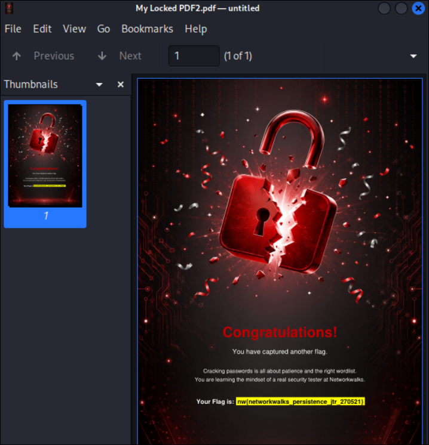
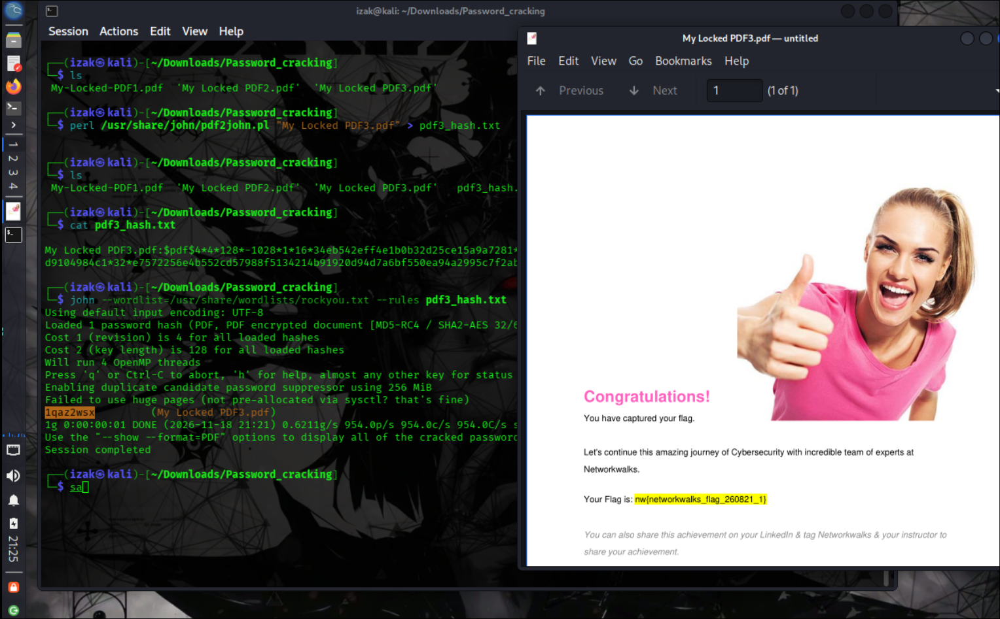

# Week 3 – Project Work: Password Cracking

*Cybersecurity & Ethical Hacking Project Tasks – NetworkWalks*

## Overview

This submission covers both **Essential** modules for Week 3:

- **W3-PM1** – Password Cracking with John the Ripper (JTR)
- **W3-PM2** – Password Cracking with NetworkWalks Tools (Hash Calculator + Password Cracker)

Module 1 (JTR) targets `PDF3.pdf`. Module 2 (NetworkWalks Tools) targets `PDF1.pdf` and `PDF2.pdf`.

**Submission deadline:** 2300H, Friday 28-August-2026

---

## Environment

- **OS:** Kali Linux
- **Tools used:**
  - John the Ripper (JTR) 
  - `john` + hash extraction utility (e.g. `pdf2john.py`)
  - NetworkWalks Hash Calculator
  - NetworkWalks Password Cracker

---

## Module 1 — Password Cracking with JTR (W3-PM1)

### Task

Crack the password of the attached PDF file (`PDF3.pdf`) using **JTR (John the Ripper)** tools on a Windows PC.

### Steps Performed

1. Extracted the password hash from `PDF3.pdf`:

   ```
   perl /usr/share/john/pdf2john.pl "My Locked PDF3.pdf" > pdf3_hash.txt
   ```
2. Ran John the Ripper against the extracted hash:

   ```
   john --wordlist=/usr/share/wordlists/rockyou.txt --rules pdf3_hash.txt
   ```
3. Displayed the cracked result:

   ```
   john --show pdf_hash.txt
   ```

### Result

- **Hash extracted:** `$pdf$4*4*128*-1028*1*16*34eb542eff4e1b0b32d25ce15a9a7281*32*b77872bfc9a24fb2f845066283a8fc1b0021446990b9e4114071a4d9104984c1*32*e7572256e4b552cd57988f5134214b91920d94d7a6bf550ea94a2995c7f2ab02`
- **Wordlist / mode used:** `rockyou.txt` (with `--rules`)
- **Password found:** `1qaz2wsx`
- **Time taken:** `0:00:00:01`
- **Flag captured:** `nw{networkwalks_flag_260821_1}`

### Screenshots

*Terminal screenshot shows `pdf2john` hash extraction, the John the Ripper run against `rockyou.txt`, and the cracked password `1qaz2wsx` highlighted. The unlocked PDF opened to confirm the captured flag `nw{networkwalks_flag_260821_1}`.*

---

## Module 2 — Password Cracking with NetworkWalks Tools (W3-PM2)

### Task

Crack the passwords of the attached PDF files (`PDF1.pdf` and `PDF2.pdf`) using the **NetworkWalks Hash Calculator** and **Password Cracker** tools on a Windows PC.

### Steps Performed

1. Loaded `PDF1.pdf` and `PDF2.pdf` into the NetworkWalks Hash Calculator to generate their hash values.
2. Fed the resulting hash into the NetworkWalks Password Cracker tool.
3. Ran the cracking process until a match was returned.

### Result

- **PDF1.pdf**
  - Hash generated: `$pdf$4*4*128*-1060*1*16*55d1a5c14175da449753199e44971d32*32*777fd021a7f3c5ae598c0c6495c7f76e000000000000000000000000000000*32*ceecdac74b19b5a62688d3b3524e1374c955cbb9cc3c45316494d9446ef81f1`
  - Password found: `password1`
  - Time taken: `91/100 Passwords`
- **PDF2.pdf**
  - Hash generated: `$pdf$4*4*128*-1028*1*16*0853f2cde0ef15b1c0f93ed229d3b1ad*32*8f13ce5aa39ad974364d36a057da76790021446990b9e4114071a4d9104984c1*32*ceecdac74b19b5a62688d3b3524e1374c955cbb9cc3c45316494d9446ef81f1`
  - Password found: `password1`
  - Time taken: `91/100 Passwords`

### Screenshots






---

## Comparison: JTR vs NetworkWalks Tools

| Criteria | JTR | NetworkWalks Tools |
| --- | --- | --- |
| Ease of use | Good — need to know command syntax | Excellent — simple GUI, no commands needed |
| Speed | Excellent — cracked PDF3.pdf in ~1 second | Excellent — clean File/Hash/Password/Time layout |
| Interface | CLI | GUI |
| Output clarity | Good — password shown inline in terminal output | Excellent — clean File/Hash/Password/Time layout |
---

## Conclusion

Both cracking approaches successfully recovered the target passwords. JTR cracked `PDF3.pdf` in 1 second against the `rockyou.txt` wordlist, recovering the password `1qaz2wsx` and unlocking a flag (`nw{networkwalks_flag_260821_1}`). The NetworkWalks Hash Calculator and Password Cracker recovered `password1` for both `PDF1.pdf` and `PDF2.pdf` after checking 91 of 100 candidate passwords. The command-line JTR workflow was faster and more flexible (custom wordlists, rules), while the NetworkWalks GUI tools were simpler to follow step by step but limited to their built-in candidate list.